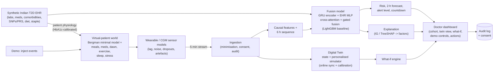

# T2D Digital Twin: real-time hyperglycemia early warning (PoC)

> ## ⚠️ SYNTHETIC DATA ONLY: NOT FOR CLINICAL USE
> Research prototype. Every patient and every signal is simulated. It is not a medical device and has no
> clinical validation. See [docs/PRIVACY_ETHICS.md](docs/PRIVACY_ETHICS.md).

A per-patient **Digital Twin** for **Type 2 Diabetes in an Indian / South-Asian context**. It fuses a
static synthetic **EHR** (demographics, labs, medications, comorbidities, simulated risk SNPs + PRS,
diet and staple) with a live **wearable/CGM stream** (CGM every 5 min, HR, HRV, sleep stages, steps,
SpO2, meal and medication logs). Every 5 simulated minutes it predicts whether glucose will exceed
**180 mg/dL within the next 120 minutes** and outputs:

* a calibrated spike probability and a **GREEN / AMBER / RED** level with a "predicted spike in ~X min" countdown,
* a **forecast at +30/60/90/120 min** with a P10–P90 band,
* a **plain-language explanation** (TreeSHAP / Integrated Gradients grouped into clinical factors),
* a secondary hypoglycemia (advisory) and nocturnal-risk flag,
* **what-if simulations** (walk now, metformin now, dinner at 19:00 vs 21:00, sleep 5 h vs 8 h) from a
  personalised physiological model inside the twin.

A clinician dashboard (React) shows it all live. You can **inject events** (heavy carb meal, missed
medication, poor-sleep night, sensor dropout, exercise, stress) and watch the prediction react.

---

## Quick start (one command)

Requirements: Python 3.11+ (3.12 recommended), Node 18+, ~3 GB disk. [uv](https://docs.astral.sh/uv/) is used if installed.

```bash
make setup     # venv + CPU PyTorch + Python deps + frontend deps
make demo      # generates data, trains (~14 min CPU) and builds the UI if missing, then serves http://127.0.0.1:8000
```

On Windows without `make`, use the same targets through `python tasks.py <target>`:

```powershell
python tasks.py setup
python tasks.py demo
```

Other targets: `make data`, `make train`, `make evaluate`, `make build`, `make dev` (hot reload on :5173),
`make test`. Docker: `docker compose up --build` (the first start generates data and trains inside the container).

Configuration lives in [config/default.yaml](config/default.yaml). Any key can be overridden by env var, e.g.
`DT__COHORT__N_PATIENTS=300 DT__COHORT__N_DAYS=60 make data`.

---

## Architecture



Details: [docs/ARCHITECTURE.md](docs/ARCHITECTURE.md).

| Folder | Content |
|---|---|
| [`data_gen/`](data_gen) | EHR generator, Indian meal library, physiology engine, world/lifestyle/sensor simulator, FHIR export, Synthea / open-CGM / MIMIC adapters (optional) |
| [`ml/`](ml) | Features and labels, LightGBM baseline, PyTorch fusion model, training, evaluation, report, explainability |
| [`twin/`](twin) | `DigitalTwin`, personalised simulator, what-if engine, serving predictor |
| [`backend/`](backend) | FastAPI + WebSocket engine, audit/consent store, external stream client |
| [`frontend/`](frontend) | React + Vite + TypeScript + Tailwind + Recharts dashboard |
| [`reports/`](reports) | `evaluation_report.md`, `metrics.json`, figures |
| [`docs/`](docs) | Architecture, data dictionary, assumptions register, privacy & ethics, demo script, presentation summary |
| [`tests/`](tests) | pytest suite (generator, physiology, features causality, alerts, twin, API) |

---

## How it works (short)

1. **Data generation** (`make data`, ~1 min). 150 synthetic patients x 30 days at 5-min resolution. Each
   patient's physiology (insulin sensitivity, beta-cell function, drug effects, dawn phenomenon) is derived
   from their EHR. The basal glucose set-point is calibrated so the simulated mean glucose matches the
   **HbA1c-implied average glucose**, which makes the EHR actually shape the signals (GMI vs HbA1c r ≈ 0.95).
   Indian meals (idli-sambar, poha, dal-chawal, roti-sabzi, biryani, millet…) have glycemic-load-based
   absorption. Sleep debt lowers next-day insulin sensitivity, stress lowers HRV, and the CGM has lag,
   noise, drift, dropouts and night-time compression lows. **All assumptions are listed in
   [docs/ASSUMPTIONS.md](docs/ASSUMPTIONS.md).**
2. **Models** (`make train`, ~14 min on a laptop CPU, including evaluation). LightGBM on 118 engineered
   causal features (68 wearable + 3 clock + 47 EHR), and a PyTorch fusion network: a GRU over a 6-h multichannel window, an EHR MLP,
   cross-attention where the EHR embedding queries the time steps, a gated fusion layer, and heads for
   spike, hypo and P10/P50/P90 glucose at 4 horizons. Each is trained as wearable-only, EHR-only and
   fused (ablation). Isotonic calibration and alert thresholds are fitted on validation patients.
3. **Twin.** Holds the profile, a rolling 50-h buffer and a personalised physiological simulator. The
   simulator starts from an EHR-only prior, syncs to every CGM reading (observer), re-calibrates
   insulin sensitivity and basal set-point every 6 h, and runs counterfactual what-if roll-outs.
4. **Real-time.** The backend runs the virtual-patient world (1x–900x) and pushes every 5-min record
   through ingestion, then the twin, then the model, then the WebSocket. Injected events change the
   *physiology*, so the model only sees them through the data, as it would in reality.

---

## Results (held-out test patients, synthetic data)

All numbers come from `reports/metrics.json`, produced by `make train` (seed 42; 105 train / 22 val / 23
**unseen test patients**; predictions every 5 min). Spike prevalence among eligible rows is 0.31, which is the PR-AUC of
a random model. **These are results on simulated patients and say nothing about clinical performance.**

**Ranking quality and ablation** (spike > 180 mg/dL within 120 min):

| Variant | GBM ROC-AUC | GBM PR-AUC | Deep ROC-AUC | Deep PR-AUC | Cold-start PR-AUC (GBM / deep) |
|---|---|---|---|---|---|
| EHR-only | 0.878 | 0.754 | 0.860 | 0.727 | 0.790 / 0.751 |
| Wearable-only | 0.942 | 0.882 | 0.936 | 0.871 | 0.864 / 0.843 |
| **Fused** | **0.943** | **0.882** | **0.938** | **0.873** | **0.883 / 0.863** |

**Live alerting** (replay of the real-time system on test patients, RED notification threshold set on validation
patients to ≤ 1 false alert/patient-day):

| Model | Spike onsets detected | Mean lead time | False alerts / patient-day |
|---|---|---|---|
| **Deep fusion (served)** | **80%** | **45 min** | 1.01 |
| Deep wearable-only | 75% | 48 min | 1.02 |
| LightGBM fused | 63% | 37 min | 0.71 |

The AMBER "watch" level (sensitivity-oriented) flags 98% of onsets with a mean lead of **~85 min**, but at
~4.4 false flags per patient-day. That's why it's a visual watch level and not a notification.

**Forecast** (deep P50, RMSE in mg/dL vs persistence): +30 min 18.8 (21.4), +60 min 25.2 (33.9), +90 min 27.8
(41.9), +120 min 29.9 (46.2). The P10–P90 band covers 71–75% (target 80%), so it is slightly over-confident.

**What the ablation shows (honestly):**
* With ≥ 24 h of wearable history, fusion barely changes ROC/PR-AUC (+0.002 deep, ±0.000 GBM). In this simulator,
  a day of CGM already carries most of what the EHR says about glycemic control.
* Fusion **does** help where it matters operationally. At **cold start** (first monitoring day) it adds +0.02 PR-AUC
  for both model families. At the **notification operating point**, the fused deep model detects 80% vs 75% of
  spikes at the same false-alert budget.
* Robustness (CGM noise, 30% CGM dropout, 50% missing smartwatch data, no meal logs) costs at most ~0.02 PR-AUC.
  Fairness by age, sex, South-Asian BMI band and urban/rural is reported but based on only 23 test patients.

**Compute:** data ~1 min. `make train` on a 4-core laptop CPU (i7-8665U, no GPU): ~6 min training plus ~6–9 min
evaluation (bootstrap CIs, cold start, temporal hold-out, fairness and 4 robustness scenarios). Total ~12–15 min.

Full report with ablations, calibration, temporal hold-out, cold start, fairness and robustness:
**[reports/evaluation_report.md](reports/evaluation_report.md)**.

---

## Limitations

* **Synthetic data.** The same simulator produces the inputs and the labels, so the models partly learn
  our own assumptions. Real-world performance will be lower and must be measured on real data.
* **Not a medical device**, with no clinical validation. The what-if outputs are model estimates, not
  treatment advice. Insulin dosing is out of scope.
* **Small test set** (~23 patients). Subgroup (fairness) estimates are noisy.
* **Hypoglycemia** is rare in the cohort, so the hypo head is advisory only.
* The physiology is a simplified Bergman minimal model, not the validated UVA/Padova simulator.
* **Bias risks.** The diet, activity and urban/rural patterns are generator assumptions and may encode
  stereotypes. Equity of access (CGM cost) is not addressed by the model.
* No authentication in the PoC (binds to localhost). A deployment needs SSO/RBAC, TLS and encryption at rest.

**Path to real-world validation:** retrospective study on consented Indian CGM + EHR data under ethics
approval, then **federated learning** across sites, **ABDM / FHIR R4** integration (FHIR export is
already included), a prospective silent trial, and CDSCO SaMD regulatory work. See
[docs/PRIVACY_ETHICS.md](docs/PRIVACY_ETHICS.md).

## Data sources

| Source | Status |
|---|---|
| Custom synthetic Indian T2D EHR generator | **In use** |
| Physiological wearable/CGM world simulator | **In use** |
| Synthea (diabetes / metabolic-syndrome modules) | Optional adapter: [data_gen/synthea/](data_gen/synthea) |
| Open CGM datasets (Shanghai T1DM/T2DM, CGMacros, D1NAMO) | Optional loader: [data_gen/open_cgm.py](data_gen/open_cgm.py). Download them yourself under their licences |
| MIMIC-IV | Optional credentialed adapter: [data_gen/mimic_adapter.py](data_gen/mimic_adapter.py) |

Demo script: [docs/DEMO.md](docs/DEMO.md) · Presentation summary: [docs/PRESENTATION.md](docs/PRESENTATION.md) · Plan: [PLAN.md](PLAN.md)
