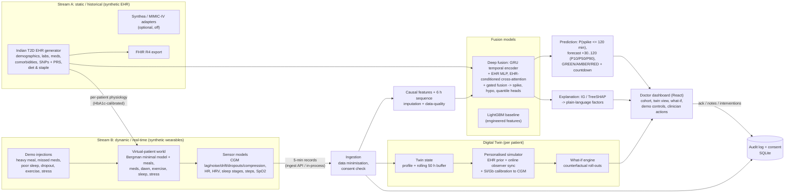

# Architecture

## End-to-end flow

## Components

| Layer | Module | Notes |
|---|---|---|
| EHR generator | `data_gen/ehr_generator.py` | Correlated synthetic Indian T2D cohort, hidden latent traits kept separate |
| Physiology | `data_gen/physiology.py` | Vectorised over patients: the same code serves batch generation, the live stream and the twin's simulator |
| World / lifestyle / sensors | `data_gen/world.py` | Rolling 3-day per-minute input buffer, live injections, 5-min emission |
| Features | `ml/features.py` | One function for training and serving, so train and serve features cannot drift |
| Models | `ml/gbm.py`, `ml/deep.py` | Isotonic calibration on validation patients |
| Evaluation | `ml/evaluate.py`, `ml/report.py` | Patient split + temporal hold-out + cold start + fairness + robustness |
| Explainability | `ml/explain.py` | TreeSHAP or Integrated Gradients, grouped into 14 clinical factors with sentence templates |
| Twin | `twin/twin.py`, `twin/simulator.py`, `twin/whatif.py`, `twin/predictor.py` | |
| Backend | `backend/engine.py`, `backend/app.py`, `backend/audit.py`, `backend/stream_client.py` | FastAPI + WebSocket; internal or external stream mode |
| Frontend | `frontend/src` | React 18 + Vite + TS + Tailwind + Recharts; colour-blind-safe Okabe-Ito palette; dark/light |

## Real-time loop (every 5 simulated minutes)

1. `World.advance_block()` integrates 5 x 1-min physiology steps for every demo patient and emits
   one device record per patient. It also emits any **logged** events (meal logs, pill box, insulin pen).
2. `Engine.ingest()` minimises the record to device fields and passes it to the twin.
3. `DigitalTwin.ingest()` appends the record to the buffer, advances the personalised simulator with the
   observed inputs and corrects it towards the CGM reading (observer gain 0.35). Every 6 simulated
   hours it re-calibrates the SI and Gb multipliers on the last 24 h (63-candidate vectorised grid
   search with shrinkage).
4. `DigitalTwin.update_prediction()` computes the features and runs the served model. Alerts fire at
   AMBER/RED with a 60-min refractory period, and each alert's outcome is tracked
   (spike occurred / no spike).
5. The WebSocket pushes the cohort summaries to every client and the full twin view to clients that
   are watching that patient. The explanation is recomputed for watched patients only.

Speeds: 1x (real-time), 10x, 60x (default), 300x, 900x. Measured on the development laptop (i7-8665U, 4 cores):
startup/warm-up ≈ 30 s, and one tick ≈ 0.8 s for 12 patients (~65 ms per patient, mostly feature computation).
At 900x the clock runs as fast as the ticks allow.

## Why a mechanistic simulator inside the twin?

The ML models answer "what will probably happen?" from data. They cannot answer counterfactual
questions ("what if the patient walks now?") because the data contains no interventions. The twin
therefore also holds a **personalised physiological model**. It starts from an EHR-derived prior
(it never sees the hidden truth) and is kept on track by the CGM through observer correction and
periodic re-calibration. The what-if engine runs all scenarios in parallel from the current
synchronised state.
