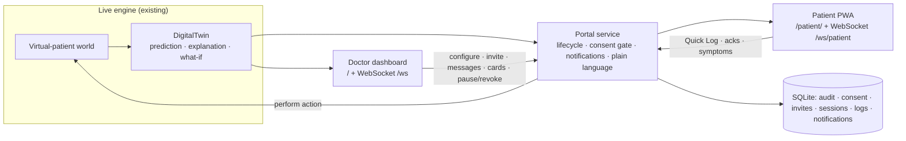

# Patient interface: architecture, security and assumptions

> SYNTHETIC DATA ONLY: NOT FOR CLINICAL USE.

## Concept
The patient app exists only because a doctor launches it for a specific, assigned patient. Patients never
self-register. The **twin (`Engine.twins[pid]`) is the single source of truth**. The doctor dashboard and the patient
PWA are two role-based clients of the same twin and the same 5-minute engine tick.



## Lifecycle
`NOT_ENROLLED -> INVITED -> CONSENT_PENDING -> ACTIVE <-> PAUSED`. Any non-terminal state can go to `REVOKED`, and
`REVOKED -> INVITED` re-launches. `INVITED -> INVITED` and `CONSENT_PENDING -> INVITED` are *regenerate*. All other
transitions return **409**. Every transition is written to the audit log with actor, from, to and reason
(`backend/portal/lifecycle.py`, tested in `tests/test_portal.py`).

| Step | Who | API |
|---|---|---|
| Enrol (existing or **new synthetic** patient) | doctor | `POST /api/portal/patients/{pid}/enroll`, `POST /api/portal/patients/new` |
| Configure (templates, bounds) | doctor | `POST …/template-config`, `PUT …/config` |
| Launch / resend / regenerate | doctor | `POST …/launch`, `…/resend`, `…/regenerate`, `POST /api/portal/bulk-invite` |
| Open invite -> OTP | patient | `POST /api/portal/invite/open`, `POST /api/portal/invite/verify` |
| Consent / withdraw / language | patient | `POST /api/portal/me/consent`, `…/withdraw`, `…/language` |
| Pause / resume / revoke / preview | doctor | `POST …/pause`, `…/resume`, `…/revoke`, `…/preview-token` |
| Live data | patient | `GET /api/portal/me`, `WS /ws/patient` |
| Two-way | both | `…/me/logs`, `…/me/tryit`, `…/me/alerts/{id}/ack`, `…/me/cards/{id}/done`, doctor `…/messages`, `…/cards` |

## Security and privacy controls (DPDP Act / HIPAA-aligned, PoC level)
| Control | Implementation |
|---|---|
| Synthetic only | No real PII/PHI. Pseudonymous IDs (`TWN-…`). Fictional doctors and contacts |
| Consent gate | `/me` returns no twin data unless the state is `ACTIVE` **and** the session is current. Before consent the app receives only the consent document. Withdrawal sets `REVOKED`, clears the session, closes WebSockets and rejects logs (tested) |
| Invite security | JWT (HS256, 48 h) plus a server-side record, so invites are **single-use**; regenerate/revoke supersede them; expiry is checked against the record |
| OTP | 6 digits, stored as a salted hash, 5-min expiry, **5 wrong codes lock the invite**, per-IP + per-invite rate limit (429). Delivery is a **mock outbox** |
| Device binding | The client sends a random device id. Its hash is bound at OTP verification and checked on every patient request and WebSocket |
| RBAC (JWT roles) | `doctor` (only assigned patients), `patient` (only own data, bound device, current session), `caregiver` (read-only status + safety alerts, only with patient consent and the doctor's feature flag), `preview` (doctor's read-only "view as patient") |
| Audit | Invites, OTP sent/failed, consent accepted/withdrawn, configuration edits (changed sections), state changes, views, previews, logs, messages, cards. The patient can read their **access log** |
| Data minimisation | The patient payload contains no EHR internals, model features or other patients. Logs keep only what is needed. Escalation contacts are fictional strings |
| Secrets | `DT_JWT_SECRET` env var, or a random secret generated into `data/.jwt_secret` (gitignored) |

**Not production-ready:** demo password for doctors (`DT_DEMO_PASSWORD`, default `demo`), in-memory rate limiter, no
TLS, no refresh-token rotation, and the WebSocket token sits in the query string. See docs/PRIVACY_ETHICS.md for the path to a real deployment.

## Safety guardrails
* **RED and low-glucose alerts are hard-wired on.** In the config schema `red_alerts` and `low_glucose_alerts` are
  `Literal[True]` (422 otherwise). The notifier treats them as priority 0: they are never capped and are only
  de-duplicated per episode (60 min RED, 30 min detected low).
* Low glucose = CGM < 70 (detected), or predicted hypo risk >= 0.25 / P50 < 72 at +30–60 min. The alert shows first aid
  (15 g fast sugar, re-check in 15 min), an emergency prompt with **tap-to-call 108**, and "tell your doctor".
  Logging dizziness or sweating also returns the first-aid card.
* Unacknowledged safety alerts **escalate** after `escalate_after_min` to the configured (fictional) contacts and the doctor (mock outbox).
* Configurable bounds: target low 70–100, high 140–200, span >= 60; heads-up threshold 25–90%; cap 1–8/day; gap 30–240 min.
  The RED threshold is the validated model threshold and cannot be configured.
* Every alert carries a confidence label (calibrated probability) and "Estimate from a synthetic demo. Not medical advice."
* The app never diagnoses and never changes medication. Medication items are reminders of the existing prescription.
  "Medicine questions? Message your doctor." Try-It covers lifestyle only (walk, roti vs rice, earlier dinner).

## Daily consumption pattern and personal food-impact detection
`backend/portal/food_insights.py`. The twin keeps a 14-day **food diary** (every logged meal: time, item, carbs).
For each meal it measures *this patient's* response from their own CGM: baseline, peak in the next 150 min,
rise, minutes above the target and time to peak. Meals followed by another meal within 90 min stay in the diary but are
excluded from the statistics, because their responses overlap. It then reports:

| Output | Rule |
|---|---|
| **Foods to watch** | n >= 2 meals **and** consistently above target (>= 2/3 of meals, or mean peak >= target + 40) **and** clearly worse than the patient's usual meal (mean rise >= 1.2x their median rise, or mean peak >= their median peak + 20). Evidence level from n: low (1) / medium (2–3) / high (>= 4) |
| **Patterns** | Late dinners (>= 21:00) vs earlier dinners; rice meals vs roti/millet meals. Reported only if both groups have >= 2 meals and differ by >= 15 mg/dL |
| **Symptom ↔ food links** | Each Quick Log symptom (dizzy, thirsty, tired, sweaty) is linked to foods eaten in the 4 h before, with the glucose at that moment. Shown as a pattern when it repeats (>= 2) |
| **Daily diary** | Per day over 7 days: meals, total carbs, meals followed by a high, late meals, sweets |
| **Warning** | When a flagged food is logged again: "The last N times after biryani your sugar often went above 180 (average peak X). A short walk after eating, or a smaller portion, can help." It is a capped, non-safety notification and appears in the doctor's audit (`food_warning`) |

The patient sees this in **My Day -> My food patterns** (localised). The doctor sees **Food and symptom insights** on the
twin page (`GET /api/patients/{pid}/food`). These are per-patient associations, not causal proof, and only *logged*
meals are analysed.

## Demo patient accounts (demo only)
Three synthetic patients are pre-activated at startup when `portal.demo_accounts_enabled: true` (the default for the demo).
They go through the real, audited lifecycle as actor `demo-seed`:

| Account | Language | Template | Doctor |
|---|---|---|---|
| demo1 | English | Standard T2D follow-up | Dr. Asha Mehta |
| demo2 | हिन्दी | On insulin (hypo-aware) | Dr. Asha Mehta |
| demo3 | தமிழ் | Older adult + caregiver | Dr. Sunil Rao |

Open http://127.0.0.1:8000/patient/ with no invite, then tap an account. This logs in on the current device and replaces
any older session, so device binding still applies. A revoked demo account is re-activated on the next demo login.
Set `DT__PORTAL__DEMO_ACCOUNTS_ENABLED=false` to remove them (the endpoint then returns 404).

## Notifications
| Priority | Kind | Rule |
|---|---|---|
| 0 | `hypo_detected`, `hypo_predicted`, `red` | always delivered, de-duplicated per episode |
| 1 | `message`, `card` (doctor) | delivered |
| 2 | `food_warning` | when a food flagged for this patient is logged again; same cap/gap as heads-ups |
| 2 | `amber` heads-up | only on entering the doctor's personal watch zone; capped by `daily_cap` (per simulated day) and `min_gap_min`. Suppressed ones are stored with the reason and counted in the engagement panel |
| 3 | `reminder` | at configured medication-reminder times |

## Assumptions (demo)
| # | Assumption |
|---|---|
| P1 | **Mock OTP / SMS / email delivery**: messages go to the `outbox` table, shown in the doctor's Dev outbox. The patient screen has a demo-only "show my code" button (`portal.dev_show_otp`, disable it outside demos) |
| P2 | **Simulated wearable connection**: "Connect (simulated)" only toggles UI state. Data comes from the world simulator |
| P3 | **Quick Log performs the action in the simulated world** (meal eaten, walk taken, a dose of the *existing* metformin prescription taken, or doses skipped) so the next prediction reflects it. In reality a log records what already happened |
| P4 | **Translations (Hindi, Tamil) are machine-drafted** (backend `backend/portal/i18n/*.yaml`, frontend `frontend/shared/locales/*.json`) and need native-speaker and clinical review. Meal names from the simulator's meal library stay in English (transliterated) unless they are one of the five Quick Log presets |
| P5 | Doctors and assignments are fictional: Dr. Asha Mehta (first half of the demo patients) and Dr. Sunil Rao (second half). Newly created patients belong to their creator |
| P6 | Escalation contacts must be fictional. The UI says so, but the server does not verify it |
| P7 | 108 is used as the emergency number shown in first-aid text (India's ambulance service number). Check it for the deployment region |
| P8 | Patient consent for the app is separate from the clinic's (simulated) twin-monitoring consent. Withdrawing app consent stops the app, its data channel and patient logs. Clinical CGM monitoring by the care team is governed by the clinic consent record |

## Frontend structure
```
frontend/
  doctor/   index.html + src/        (existing dashboard, migrated; Patient Interface Manager in src/portal/)
  patient/  index.html + src/        (PWA: Onboarding, Home, My Day, Try it, Quick Log, Care, Me)
  shared/   components/ (LevelBadge, StatusBadges, AlertCard, MiniForecast, Card), lib/, i18n.ts, locales/
  public/patient/  manifest.webmanifest, sw.js (offline shell, never caches API data), icon.svg
```
One Vite multi-page build. FastAPI serves the doctor app at `/` and the patient app at `/patient/`.
