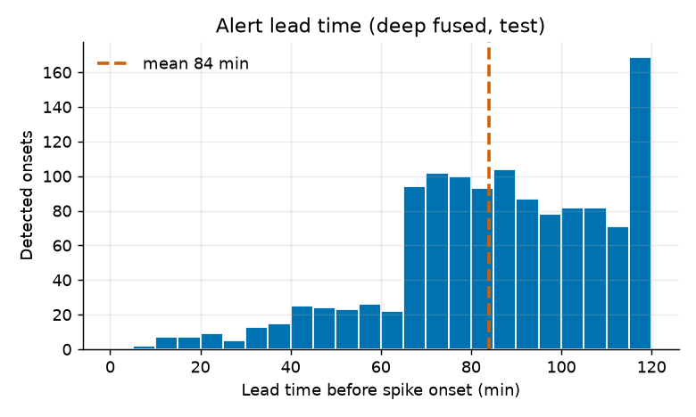
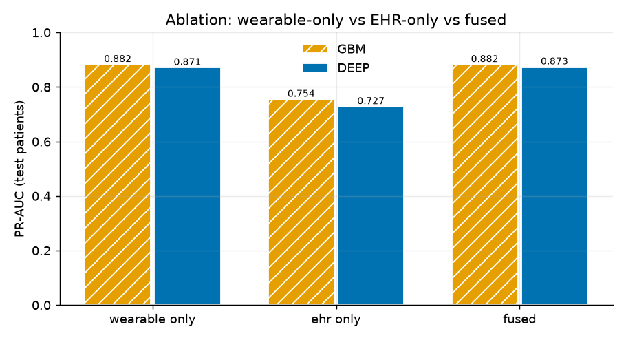
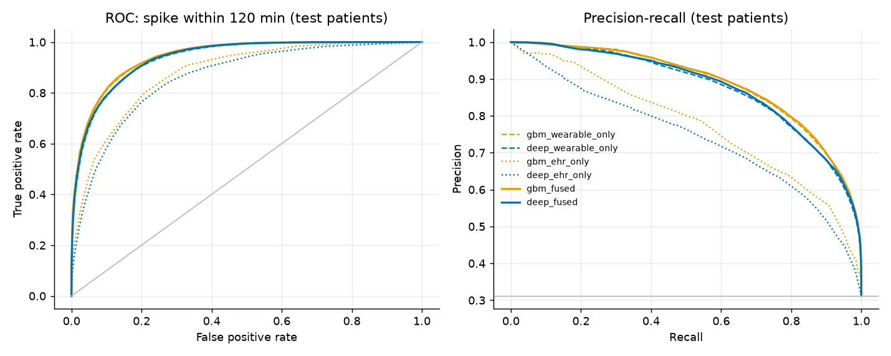
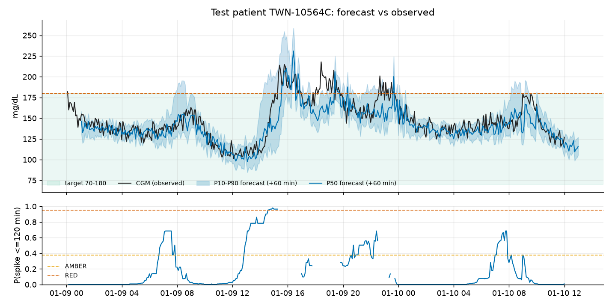
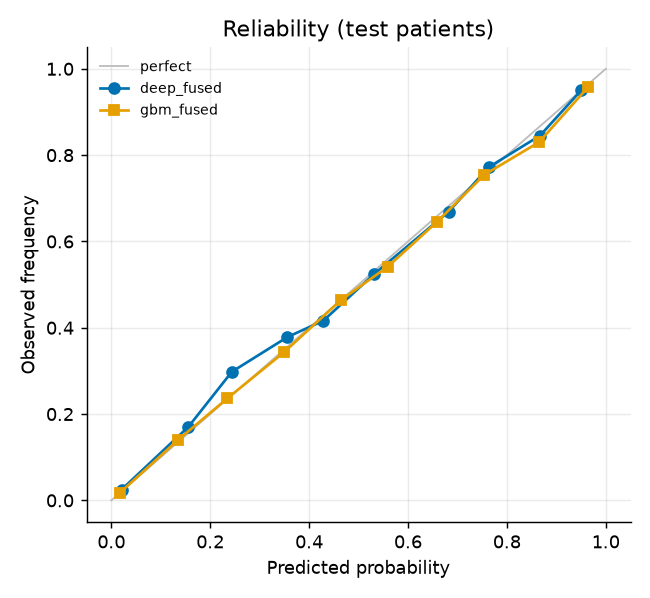
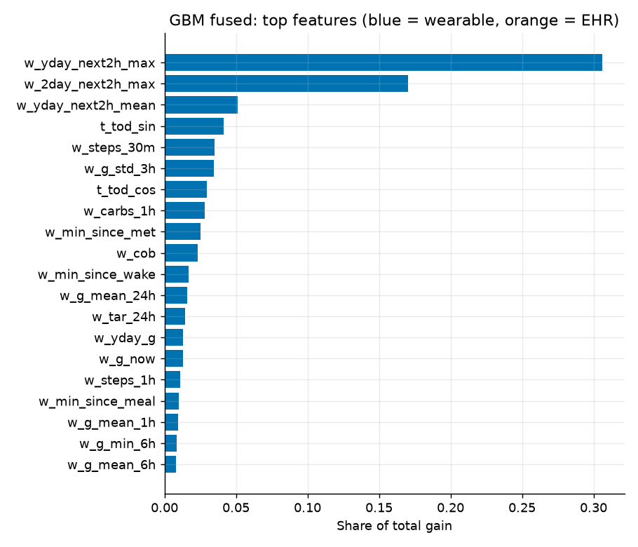

# Evaluation report: T2D Digital Twin (hyperglycemia > 180 mg/dL within 120 min)

> **SYNTHETIC DATA ONLY: NOT FOR CLINICAL USE.** All results below are on simulated patients. They measure
> how well the models recover structure that *we* put into the simulator. They say nothing about real-world
> clinical performance.

_Generated 2026-10-22 13:51 UTC by `ml/evaluate.py`. Seed 42._

## 1. Setup

* Cohort: 150 synthetic patients x 30.0 days at 5-min resolution (mean HbA1c 7.64%, TIR 72.9%, 1.85 sustained spike onsets / patient-day).
* Split **by patient**: 105 train / 22 validation / 23 test. **Temporal hold-out**: train patients after 2026-01-29 00:01 (last 20% of days). Training rows end their label window before the cut-off.
* Prediction made every 5 min whenever current CGM <= 180 mg/dL ("eligible"). Label = two consecutive CGM readings > 180 in the next 120 min.
* Alert thresholds are chosen on **validation** patients: AMBER = sample-level sensitivity >= 0.8; RED = lowest threshold whose live alert replay gives <= 1.0 false alert per patient-day. Test patients are never used for tuning. Refractory period 60 min.
* Training wall time (CPU): 338.3 s. Model served in the demo: **deep_fused**, chosen on validation patients by the operational criterion: spikes detected at the RED notification operating point (deep 0.77 vs GBM 0.62).

## 2. Headline results (test patients, never seen in training)

| Model | ROC-AUC (95% CI) | PR-AUC | Brier | Sens @AMBER | Spec @AMBER | PPV @AMBER |
|---|---|---|---|---|---|---|
| LightGBM, wearable-only | 0.942 | 0.882 | 0.089 | 0.810 | 0.900 | 0.786 |
| LightGBM, EHR-only | 0.878 | 0.754 | 0.129 | 0.806 | 0.786 | 0.630 |
| LightGBM, fused | 0.943 (0.939-0.947) | 0.882 | 0.088 | 0.815 | 0.900 | 0.786 |
| Deep, wearable-only | 0.936 | 0.871 | 0.094 | 0.786 | 0.900 | 0.780 |
| Deep, EHR-only | 0.860 | 0.727 | 0.138 | 0.764 | 0.801 | 0.634 |
| Deep fusion (GRU + EHR cross-attention, gated) | 0.938 (0.933-0.943) | 0.873 | 0.092 | 0.787 | 0.902 | 0.784 |

Prevalence of the positive class among eligible test rows: 0.312 (the PR-AUC of a random classifier). The CI (fused models) is a patient-level (cluster) bootstrap.

### Episode-level alerting (live replay, test patients)

| Model | Operating point | Spike onsets | Detected (event sensitivity) | Mean / median lead time (min) | Alert precision | False alerts / patient-day |
|---|---|---|---|---|---|---|
| LightGBM, fused | AMBER (p >= 0.45) | 1260 | 1246 (0.99) | 85 / 85 | 0.44 | 4.48 |
| LightGBM, fused | RED (p >= 0.97) | 1260 | 791 (0.63) | 37 / 35 | 0.64 | 0.71 |
| Deep fusion (GRU + EHR cross-attention, gated) | AMBER (p >= 0.38) | 1260 | 1240 (0.98) | 84 / 85 | 0.44 | 4.37 |
| Deep fusion (GRU + EHR cross-attention, gated) | RED (p >= 0.95) | 1260 | 1009 (0.80) | 45 / 40 | 0.64 | 1.01 |
| LightGBM, wearable-only | AMBER (p >= 0.42) | 1260 | 1250 (0.99) | 85 / 85 | 0.44 | 4.48 |
| LightGBM, wearable-only | RED (p >= 0.97) | 1260 | 759 (0.60) | 35 / 35 | 0.63 | 0.71 |
| Deep, wearable-only | AMBER (p >= 0.40) | 1260 | 1243 (0.99) | 83 / 85 | 0.44 | 4.36 |
| Deep, wearable-only | RED (p >= 0.92) | 1260 | 944 (0.75) | 48 / 45 | 0.63 | 1.02 |

Lead time = minutes between the first alert in the 120 min before a sustained onset and the onset. An alert counts as true if an onset follows within 120 min. The AMBER operating point (high sensitivity) produces several false alerts per patient-day, which is too many for push notifications. The dashboard therefore **notifies at RED** and shows AMBER only as a watch level on the badge and gauge.

## 3. Ablation: does fusion help?

| Variant | GBM PR-AUC | Deep PR-AUC | GBM ROC-AUC | Deep ROC-AUC | Deep RMSE@60 (mg/dL) |
|---|---|---|---|---|---|
| wearable only | 0.882 | 0.871 | 0.942 | 0.936 | 24.9 |
| ehr only | 0.754 | 0.727 | 0.878 | 0.860 | 32.3 |
| fused | 0.882 | 0.873 | 0.943 | 0.938 | 25.2 |

**Fusion gain over wearable-only with full (>= 24 h) history (PR-AUC):** deep +0.002, GBM -0.000.

### Cold start: first day of monitoring (6-24 h of history, test patients)

When a patient has just started wearing the devices, 24-h CGM features, yesterday's pattern and the sleep history are incomplete. The static EHR then has to carry the patient-specific context.

| Variant | GBM PR-AUC | Deep PR-AUC | GBM ROC-AUC | Deep ROC-AUC | Rows |
|---|---|---|---|---|---|
| wearable only | 0.864 | 0.843 | 0.891 | 0.870 | 3315 |
| ehr only | 0.790 | 0.751 | 0.840 | 0.806 | 3315 |
| fused | 0.883 | 0.863 | 0.906 | 0.893 | 3315 |

**Fusion gain at cold start (PR-AUC):** deep +0.020, GBM +0.019.

**Fusion at the notification operating point (deep, RED, test):** 0.80 of spike onsets detected with 1.01 false alerts/patient-day (fused) vs 0.75 with 1.02 (wearable-only). Each RED threshold was set independently on validation patients to the same false-alert budget.

**Interpretation.** EHR-only models carry no information about the current state, so they learn time-of-day x patient-control risk. Wearable-only models with a full day of history already encode most of what the EHR says about glycemic control, because 24 h of CGM is a strong proxy for HbA1c, medication effect and meal habits. In this simulator the ranking metrics (ROC/PR-AUC) barely move with fusion in the steady state. The gains show up at cold start and at the high-specificity alerting operating point, where the EHR context helps separate patients who reliably spike from those who do not. We report both as they are.

## 4. Glucose forecast (multi-horizon, all test rows)

| Horizon | Deep P50 RMSE | Deep P50 MAE | GBM RMSE | GBM MAE | Persistence RMSE | Deep P10-P90 coverage (target 0.80) |
|---|---|---|---|---|---|---|
| +30 min | 18.8 | 13.0 | 14.7 | 10.2 | 21.4 | 0.75 |
| +60 min | 25.2 | 17.0 | 22.6 | 15.0 | 33.9 | 0.71 |
| +90 min | 27.8 | 18.7 | 28.3 | 18.9 | 41.9 | 0.71 |
| +120 min | 29.9 | 20.2 | 31.1 | 21.1 | 46.2 | 0.72 |

## 5. Calibration

Both fused models are isotonic-calibrated on validation patients. Brier scores are in section 2.

## 6. Temporal hold-out (train patients, future days)

| Model | ROC-AUC | PR-AUC | Brier | False alerts / patient-day | Mean lead (min) |
|---|---|---|---|---|---|
| LightGBM, fused | 0.952 | 0.893 | 0.079 | 4.14 | 85 |
| Deep fusion (GRU + EHR cross-attention, gated) | 0.950 | 0.890 | 0.080 | 3.99 | 84 |

## 7. Secondary target: hypoglycemia (< 70 mg/dL within 120 min)

Deep fused hypo head on test: ROC-AUC 0.902, PR-AUC 0.009, with only **53 positive rows** (prevalence 0.0003). The synthetic cohort has very little hypoglycemia, so this estimate is unreliable and the dashboard only shows the hypo flag as advisory.

## 8. Fairness (test patients, by subgroup)

Only 23 test patients, so subgroup estimates are noisy. Treat differences as hypotheses, not findings.

Sensitivity and false alerts (FA/day) are measured at the AMBER threshold.

| Attribute | Group | Patients | Prevalence | Deep ROC-AUC | Deep PR-AUC | Deep sens | Deep FA/day | GBM PR-AUC |
|---|---|---|---|---|---|---|---|---|
| age_group | 45-59 | 14 | 0.32 | 0.939 | 0.880 | 0.77 | 4.26 | 0.887 |
| age_group | <45 | 5 | 0.34 | 0.942 | 0.892 | 0.81 | 4.57 | 0.896 |
| age_group | >=60 | 4 | 0.25 | 0.936 | 0.838 | 0.81 | 4.48 | 0.843 |
| sex | F | 10 | 0.32 | 0.935 | 0.873 | 0.77 | 4.33 | 0.882 |
| sex | M | 13 | 0.30 | 0.941 | 0.874 | 0.80 | 4.40 | 0.881 |
| bmi_band_sa | normal | 6 | 0.30 | 0.942 | 0.878 | 0.73 | 3.43 | 0.884 |
| bmi_band_sa | obese | 13 | 0.32 | 0.937 | 0.877 | 0.80 | 4.99 | 0.884 |
| bmi_band_sa | overweight | 4 | 0.28 | 0.940 | 0.861 | 0.83 | 3.76 | 0.868 |
| region | rural | 10 | 0.27 | 0.940 | 0.854 | 0.74 | 3.82 | 0.860 |
| region | urban | 13 | 0.35 | 0.935 | 0.886 | 0.82 | 4.79 | 0.895 |

## 9. Robustness to sensor problems (test patients)

Inputs are perturbed and labels still come from the original CGM. The first row is the unperturbed test set. Sensitivity and FA/day are measured at the AMBER threshold.

| Perturbation | Deep fused PR-AUC | Deep wearable-only PR-AUC | GBM fused PR-AUC | GBM wearable-only PR-AUC | Deep fused sens | Deep fused FA/day | Deep fused RMSE@60 |
|---|---|---|---|---|---|---|---|
| none | 0.873 | 0.871 | 0.882 | 0.882 | 0.79 | 4.37 | 25.2 |
| cgm_noise_x3 | 0.863 | 0.860 | 0.866 | 0.867 | 0.80 | 6.66 | 29.3 |
| cgm_dropout_30pct | 0.865 | 0.861 | 0.878 | 0.878 | 0.78 | 4.10 | 26.8 |
| wearable_missing_50pct | 0.869 | 0.868 | 0.873 | 0.873 | 0.76 | 4.06 | 25.2 |
| no_meal_logs | 0.852 | 0.848 | 0.861 | 0.864 | 0.77 | 4.47 | 27.8 |

* `cgm_noise_x3`: extra 8% multiplicative + 6 mg/dL additive noise. `cgm_dropout_30pct`: 15% random loss plus a 3-h gap per day. `wearable_missing_50pct`: half of all smartwatch hours missing. `no_meal_logs`: the patient logs no meals.

## 10. Most important features (GBM fused, gain)

| Feature | Share of gain |
|---|---|
| `w_yday_next2h_max` | 0.306 |
| `w_2day_next2h_max` | 0.170 |
| `w_yday_next2h_mean` | 0.051 |
| `t_tod_sin` | 0.041 |
| `w_steps_30m` | 0.035 |
| `w_g_std_3h` | 0.035 |
| `t_tod_cos` | 0.029 |
| `w_carbs_1h` | 0.028 |
| `w_min_since_met` | 0.025 |
| `w_cob` | 0.023 |
| `w_min_since_wake` | 0.017 |
| `w_g_mean_24h` | 0.016 |
| `w_tar_24h` | 0.015 |
| `w_yday_g` | 0.013 |
| `w_g_now` | 0.013 |

## 11. Honest limitations of these numbers

* The simulator generates both the inputs and the labels, so the models can learn the simulator's own rules. Real-world performance will be lower.
* Many spikes are driven by meals that have **not happened yet** at prediction time. Those are only predictable from habit (yesterday's pattern, time of day), which caps achievable precision. That is realistic.
* The test set is small at the patient level. Use the bootstrap CIs.
* Hypoglycemia is rare in the synthetic cohort, so the hypo head is not validated.
* Thresholds and calibration come from simulated validation patients. A real deployment would need site-specific recalibration and prospective validation.